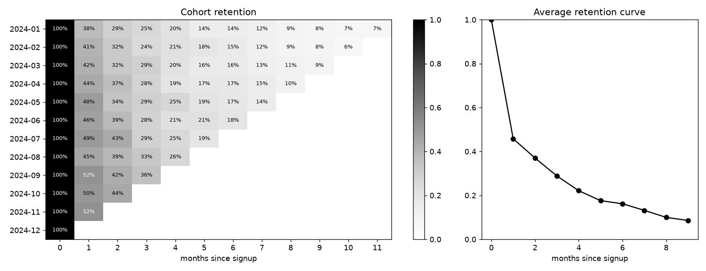

# cohort-retention-analysis

Monthly signup cohorts, retention matrix and heatmap, average retention curve.

## Task

Show how well users stay after signup and whether newer cohorts retain better than older ones.

## Approach

- Synthetic users sign up over 12 months; their return probability decays with age and is slightly higher for later cohorts.
- `core.activity_table` joins events to signups and derives cohort month and age in months.
- `core.retention_matrix` counts distinct active users per cohort and age; `mask_future` blanks cells that lie beyond the observation window so they are not read as zero retention.
- `core.average_curve` averages only over ages that have enough cohorts behind them.

## Results



- 6,000 users in 12 cohorts.
- Average retention is 45.8% after one month and 28.8% after three.
- Month-1 retention improves by about 1.28 percentage points per cohort.

## Run

```bash
pip install -r requirements.txt
python run.py      # generates data, runs the analysis, writes reports/
pytest             # unit tests
```

## Layout

```
src/data.py     data generation (fixed seed, no downloads)
src/core.py     analysis / model code
run.py          end-to-end script
tests/          unit tests
reports/        figures and summary.json produced by run.py
```

## Notes

The data is generated by `src/data.py` with a fixed random seed, so the numbers above are reproducible. It is synthetic: it is meant to show the method, and results on real data will differ.

Stack: pandas, numpy, matplotlib.
